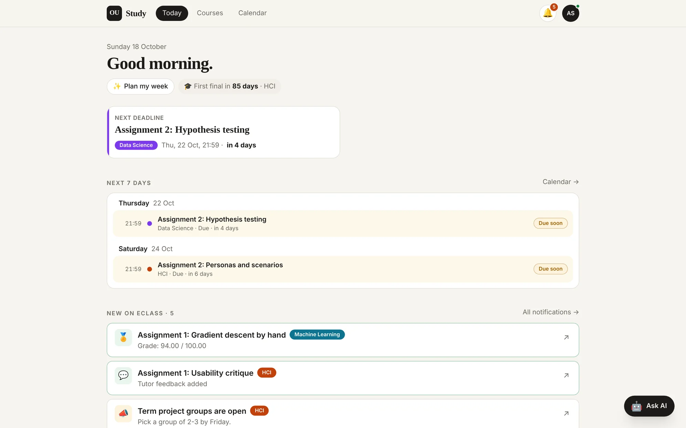
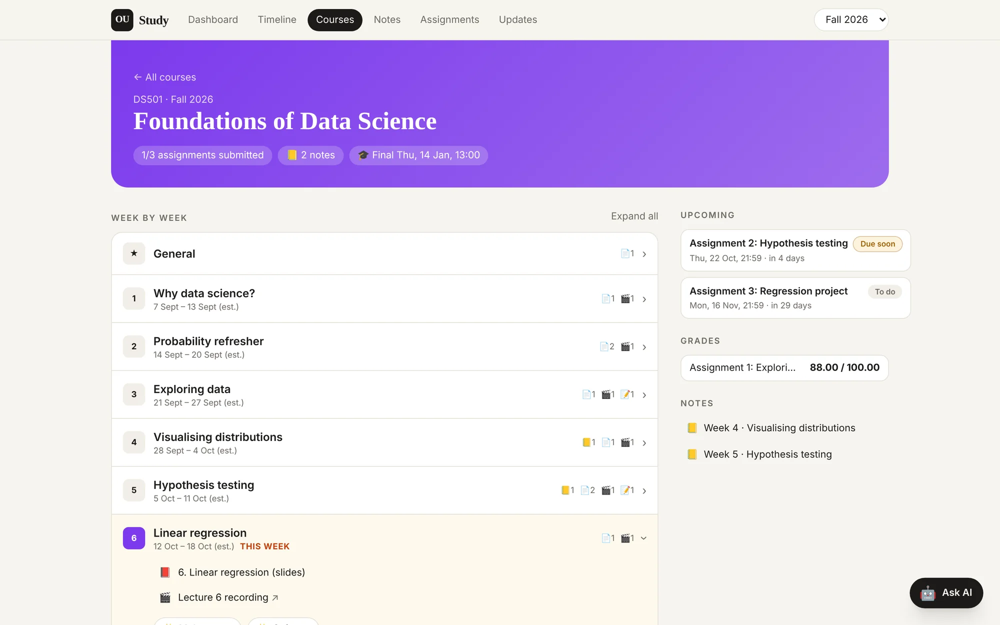
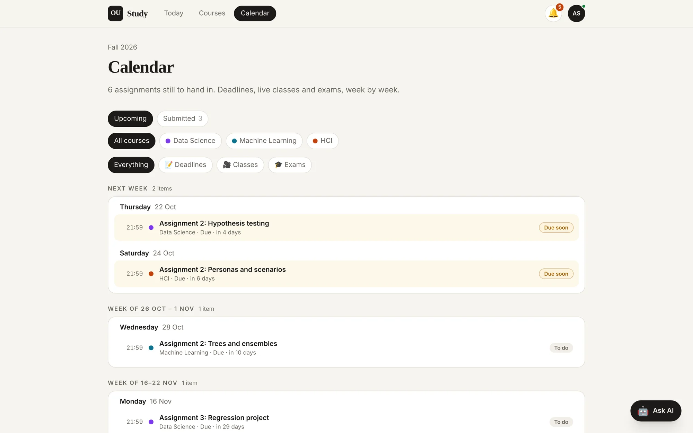
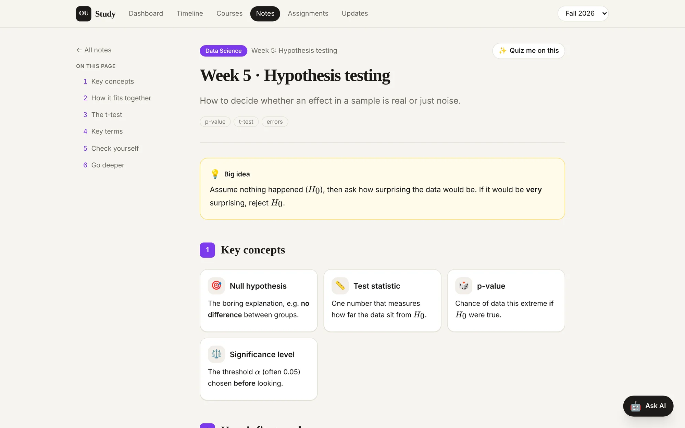
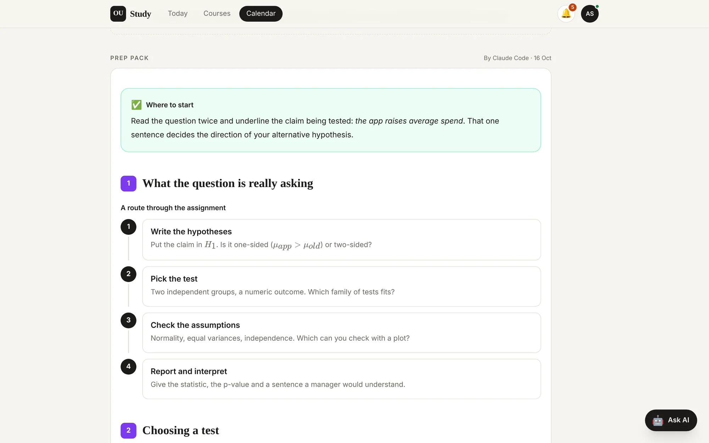
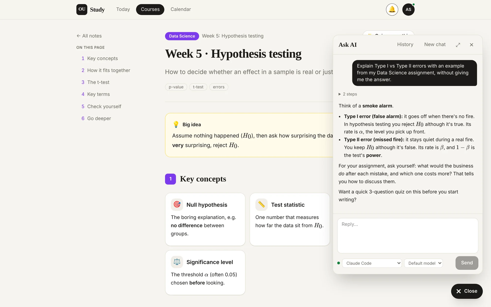
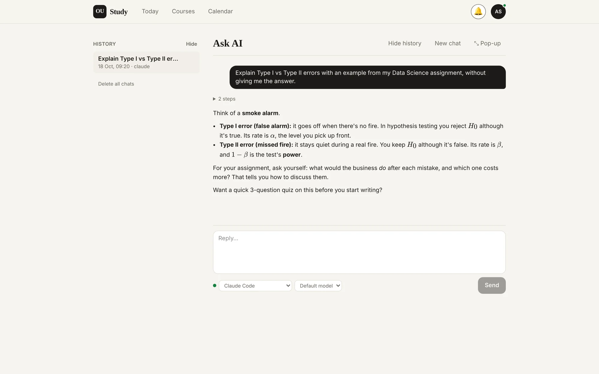
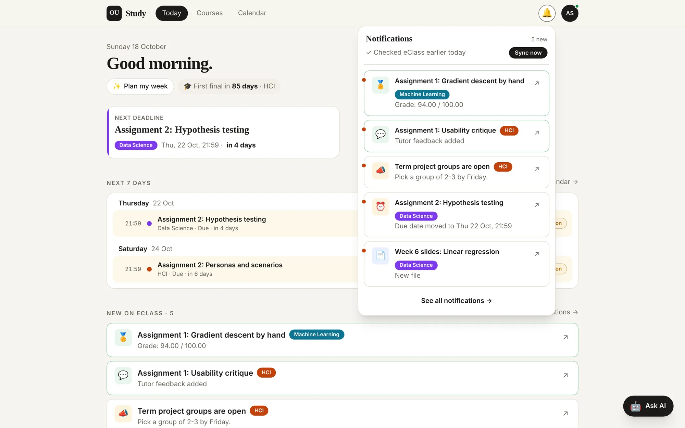
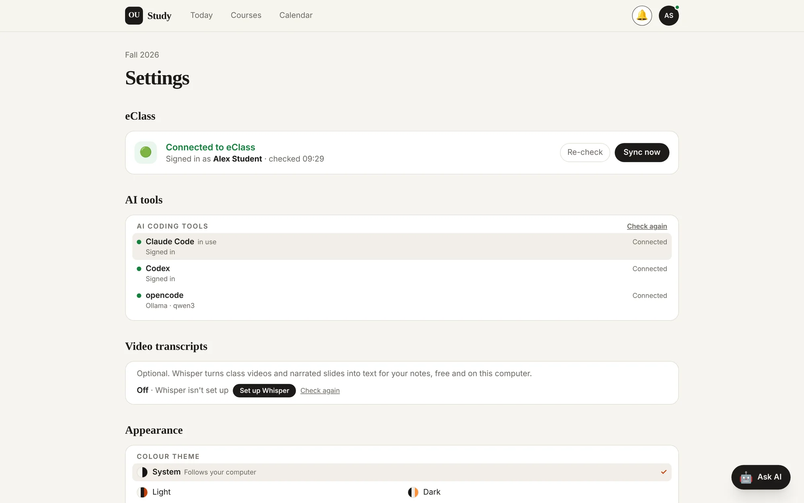
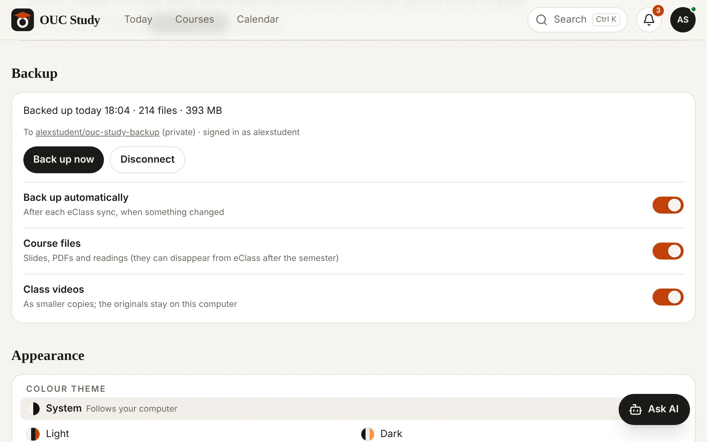

# OUC Study

Your Open University of Cyprus **eClass courses offline**, in a visual study app: every slide and file, assignment questions, your own submissions and grades, a semester timeline, daily alerts for new grades, feedback and deadlines, and AI study agents (Claude Code, Codex or a local model).

Built by students for students. Works with **your own** eClass account: nothing is shared between users.

<picture>
  <source media="(prefers-color-scheme: dark)" srcset="docs/images/today-dark.webp">
  
</picture>

<sub>Screenshots use a made-up demo semester. They follow your light or dark theme.</sub>

## A quick tour

<table>
<tr>
<td width="50%" valign="top">

<picture>
  <source media="(prefers-color-scheme: dark)" srcset="docs/images/course-dark.webp">
  
</picture>

**Every course, week by week**<br>Slides, recordings, readings, notes and quizzes for each week. **Start class** takes you through them one at a time, ticking each off.

</td>
<td width="50%" valign="top">

<picture>
  <source media="(prefers-color-scheme: dark)" srcset="docs/images/calendar-dark.webp">
  
</picture>

**Calendar**<br>Every deadline, live class and exam, week by week, with filters per course and type.

</td>
</tr>
<tr>
<td width="50%" valign="top">

<picture>
  <source media="(prefers-color-scheme: dark)" srcset="docs/images/note-dark.webp">
  
</picture>

**Visual notes**<br>Notes your AI writes from the slides and class videos: big idea, concept cards, diagrams, formulas and flashcards.

</td>
<td width="50%" valign="top">

<picture>
  <source media="(prefers-color-scheme: dark)" srcset="docs/images/assignment-dark.webp">
  
</picture>

**Assignments with a prep pack**<br>The question, your files, study links and an AI prep pack with hints, never the answers.

</td>
</tr>
<tr>
<td width="50%" valign="top">

<picture>
  <source media="(prefers-color-scheme: dark)" srcset="docs/images/ask-ai-dark.webp">
  
</picture>

**Ask AI, on any page**<br>Chat with Claude Code, Codex or a local model about what you're looking at. It knows your courses and notes.

</td>
<td width="50%" valign="top">

<picture>
  <source media="(prefers-color-scheme: dark)" srcset="docs/images/chat-dark.webp">
  
</picture>

**Or as a full page**<br>Longer conversations get the whole screen, with your chat history on the side and the AI and model next to Send.

</td>
</tr>
<tr>
<td width="50%" valign="top">

<picture>
  <source media="(prefers-color-scheme: dark)" srcset="docs/images/notifications-dark.webp">
  
</picture>

**What's new on eClass**<br>The 🔔 bell lists new grades, feedback, files, moved deadlines and announcements, with Sync now.

</td>
<td width="50%" valign="top">

<picture>
  <source media="(prefers-color-scheme: dark)" srcset="docs/images/settings-dark.webp">
  
</picture>

**Settings**<br>The eClass connection, your AI tools, video transcripts, backups and the colour theme, from the profile circle.

</td>
</tr>
</table>

## Install

Works on **macOS and Windows** (and Linux, without starting at login). You need [Node.js](https://nodejs.org) (the LTS version), [git](https://git-scm.com) and a few minutes.

```bash
git clone <this repo> OUC-Study
cd OUC-Study
npm run setup
```

On a Mac you can also double-click **`Install OUC Study.command`**, on Windows **`Install OUC Study.cmd`**. Afterwards **`Start Study App.command`** / **`Start Study App.cmd`** opens the app.

The installer walks you through everything:

1. **Checks your computer** and installs the app.
2. **Connects to eClass** with your personal key. It shows you where to get it, and you paste it hidden (or it reads it from the clipboard).
3. **Lists your enrolled courses**. The current ones are already ticked.
4. **Downloads everything**: weekly slides and files, class videos, assignment briefs and questions, your submitted files, grades and feedback.
5. **Finishes the setup**: searchable text copies for your AI assistant, Whisper for video transcripts (optional), daily updates, your preferences for the assistant.
6. **Starts the app**, automatically at every login on macOS and Windows. Open **http://localhost:5173**, or type `ouc open`.

Want to see first what it would download? Run `npm run setup -- --dry-run`. It changes nothing.

### Your eClass key

The app reads eClass through its official web-service API, the one the Moodle mobile app uses. It needs your personal key:

- eClass → **Preferences → Security keys** (https://eclass.ouc.ac.cy/user/managetoken.php), row **Moodle mobile web service** → copy (or **Reset** to get a new one).
- No such row? Install the **Moodle** app on your phone and sign in to `eclass.ouc.ac.cy` once (Office365 Login).

The key is saved in `.eclass-token`, readable only by you and never committed. **Don't share it**: it gives access to your eClass account.

## The `ouc` command

| Command | What it does |
|---|---|
| `ouc open` | open the app in your browser (starts it if needed) |
| `ouc sync` | check eClass **now**: grades, feedback, deadlines, announcements **and new files** |
| `ouc pull` | download any new course files, class videos included (`--dry-run` just lists them) |
| `ouc transcribe` | make the missing transcripts of class videos and narrated slides now (the app does it in the background; `--setup` installs Whisper) |
| `ouc setup` | add courses, start a new semester, or replace your key |
| `ouc backup` | back up your study data now; `ouc backup setup` signs in to GitHub, `ouc backup restore` gets it back on a new computer, `ouc backup status` shows the last one (see [Backups](#backups)) |
| `ouc status` | is the app running, is the daily sync scheduled, when was the last sync |
| `ouc start` · `ouc stop` · `ouc restart` | control the background app |
| `ouc update` | update to the latest release (`ouc restart` does this too; `--check` only looks, `--main` follows main instead of releases) |
| `ouc logs` · `ouc logs sync` | follow the logs (macOS `~/Library/Logs/OUC-Study/`, Windows `%LOCALAPPDATA%\OUC-Study\Logs\`) |
| `ouc check-public` | before pushing to GitHub: is anything personal included? |
| `ouc uninstall` | turn off auto-start and the daily sync |

How it runs in the background: on macOS two LaunchAgents (`~/Library/LaunchAgents/cy.ouc.study.*`); on Windows a hidden launcher in your Startup folder and a Task Scheduler task "OUC Study eClass sync" (no admin rights needed); on Linux `ouc start` runs it until you log out. Prefer no background service? `npm run dev` runs the app in the current terminal window.

## Pages

The top bar has **Today**, **Courses** and **Calendar**, plus **Search**, the 🔔 bell (notifications) and the profile circle (Settings) on the right.

- **Today**: next deadline, the next exam, the next 7 days (deadlines and live classes), what's still to watch and read this week in each course, and what's new on eClass.
- **Courses**: each course with its weeks (slides, videos, assignments, your notes, the week's live class), notes, quizzes and assignments, plus your grades. Tick off each video, slide deck, file and link as you watch or read it (a video ticks itself when it plays to the end, slides when you reach the last one); each week and course shows how much is done. **Start class** on a week goes through its videos, slides, PDFs and links one at a time in the app (a link or a Word file opens in a new tab): **Done, next** ticks the step off, **Skip** leaves it, and it picks up where you stopped. Ticks are kept on your computer in `semesters/<id>/progress.json`, where your AI reads them when it plans your week.
- **Calendar**: deadlines, live classes, exams and other important dates week by week, with filters per course and type, and your submitted work.
- **Important dates**: eClass doesn't publish exam dates in a form the app can read, so you add them yourself on a course's **Dates** tab: a title ("Final exam"), exam or other, the day, the time if you know it, and the topics it covers. **Edit** and the bin button change or remove one. Exams show on Today, Courses and the Calendar, other dates on the Calendar. Or ask the AI (**Important dates** in Ask AI): "the COS512 final is on 5 December at 13:00, weeks 1 to 10". They're saved in `semesters/<id>/_meta/dates.json`.
- **Slides**: click a PowerPoint on a course week and it opens right in the app, slide by slide (arrow keys, full screen), with no download. Slides with recorded narration have a 🔊 player under them; tick **Play as a lecture** to hear each slide and move on by itself. The app makes a PDF copy the first time you open a deck (a few seconds; kept in `.ouc/slides/`) using [LibreOffice](https://www.libreoffice.org/download/) (free; `ouc setup` offers to install it, or on a Mac `brew install --cask libreoffice`, on Windows `winget install TheDocumentFoundation.LibreOffice`). Animations and videos inside the slides don't play there: use **Download** for those.
- **Notes**: visual notes with diagrams, LaTeX formulas, comparison tables and flip-card self-tests. Each section says where its points come from, and a **Sources** list ends the note: a citation opens the PDF at that page, the slide viewer at that slide or the class video at the minute it was said (a Panopto recording opens Panopto at that minute). **Sync now** adds sources to notes made before this, a few at a time in the background.
- **Class videos and transcripts**: videos posted on eClass (for example on a week's page) download with the other course files and play in the app. Each one, and each PowerPoint with recorded narration, gets a transcript next to it (`Lecture 3.transcript.md`), and your AI makes that week's notes from it. A video opens on its own page with the transcript beside it: click a line to jump there, the line being said is highlighted as it plays, and ⛶ goes full screen. The slide viewer shows what's said on each narrated slide. Transcripts are optional and made on your computer with [Whisper](https://github.com/ggml-org/whisper.cpp), free and offline. Without Whisper the videos still download, and nothing is transcribed. `ouc setup` asks whether to install it, and **Settings → Video transcripts** in the app (the profile circle, top right) can set it up later (**Set up Whisper**) or turn transcripts off (on a Mac `brew install whisper-cpp ffmpeg` plus a speech model of about 500 MB; on Windows Python from winget if you don't have it, then `pip install faster-whisper`, whose model downloads on the first transcript; on Linux `pip install faster-whisper`), or in Terminal run `ouc transcribe --setup`. The app transcribes one file at a time in the background; **Sync now** does the weeks about to get notes first. The activity bar under the header shows what's running (sync steps and downloads, transcripts, AI notes); **Details** opens each part. Recordings on Panopto (video.ouc.ac.cy) need a Panopto sign-in, so they stay links; their captions are saved as the transcript when Panopto shares them publicly. Webconference recordings aren't reachable with the eClass key. To turn things off, put `{ "videos": false }` (no video downloads) or `{ "transcribe": false }` in `.ouc/media.json`; `"model": "base"` is faster, `"medium"` more accurate (default `"small"`). Whisper is told what language a course is spoken in: English, or Greek for a course with a Greek title. Set `"language": "el"` (or `"auto"` to let Whisper guess) on a course in `semester.json`, or for every course in `.ouc/media.json`. A transcript that came out in the wrong language is made again on the next sync, and the video page has **Make it again** with a language choice.
- **Quizzes**: scored quizzes your AI makes on the topics of the course material (the questions can go wider than the slides), for one lecture or the whole course: true/false, one answer, or select all that apply (including "All of the above"). After each answer you get a full explanation of why it is right, then your score at the end. Points (10 per right answer, 20 more for a perfect score), your best score per quiz and a daily streak 🔥 are kept on your computer in `semesters/<id>/quizzes/attempts.json`. **Make a quiz** (on the Quizzes page, a course page or a course week) opens a small pop-up: pick one class, the whole course or **Custom** (write the topics you want; keep it to the course material or let your AI use the web too), and your AI makes it in the background without opening the chat. **Sync now** makes a quiz for every class with material that doesn't have one (add `"autoQuiz": false` to `.ouc/ai.json` to turn that off). The pop-up proposes a name (you can change it). Each quiz has **Reset progress** (start it over) and **Remove**, and a course's quiz list has **Remove all quizzes**; **Reset all progress** clears every score. The format is in [`docs/QUIZ_FORMAT.md`](docs/QUIZ_FORMAT.md).
- **Assignments**: the question, files, PDF preview, study links, grade and feedback.
- **Answer it in the app**: your AI turns each new assignment into tasks you answer in the app, in the background after a sync (add `"autoHomework": false` to `.ouc/ai.json` to turn that off), and **Make it interactive** on an assignment page does it on request; for one you already submitted, the tasks come from your submission with your answers filled in. An assignment with an interactive version (`homework/tasks.json` in its folder) can be answered task by task on its own page: a timeline of the tasks, a done/left counter (also on the course's Assignments tab), written answers with bold, italic, colours, highlight, left/centre/right alignment, lists, code (inline and blocks with syntax colours), pictures (button, paste or drop) and a **Formula** button (symbol buttons, LaTeX and a live preview), multiple choice (one option, or several when the question says more than one answer can be right) with an optional "why I picked it", and true-or-false questions (True or False for each statement, with an explanation for each if you like); **Wrong type? Change it** fixes a task the AI made as the wrong type. Answers save as you type, on your computer only, and what you typed comes back after a crash. **Make PDF** saves every question, numbered and in full, with your answers (every option printed and the ones you picked struck through in red, as on paper), your name (from eClass) and the assignment title as a PDF in the assignment's `my-submission/` folder, ready to upload on eClass (it uses Google Chrome or Microsoft Edge in the background; without either, the print window opens so you can choose Save as PDF). **Ask AI about this task** starts a tutor chat on the task you're on (hints, questions back and where the material covers it, never the answer), **Make it more academic** under a written answer has the AI reword it (same ideas, your voice) and shows it next to yours to keep or turn down (a kept one is tagged "AI-edited wording"), and **Check my answers** has the AI check them in the background without being picky: right, could be better or not right yet, with a hint for each (each answer is checked once, then again only if you change it or it wasn't right), and **Discuss** on a task's check talks it through with you and corrects the check when you're right (it never gives the answer); **Complete and review** on the last task marks it done and starts that check. The format is in [`docs/HOMEWORK_FORMAT.md`](docs/HOMEWORK_FORMAT.md).
- **Search** (top bar, or ⌘K on a Mac / Ctrl K on Windows): finds words in your notes, slides and PDFs (their text copies in `text/`), class video and slide transcripts, assignments (question, prep pack, your working notes) and eClass announcements and forum posts. Results are grouped by course and week; a transcript result opens the video at the moment it's said, a slide result opens that slide, a PDF opens at that page. Accents and capitals don't matter. It runs on your computer and needs no AI tool.
- **Notifications** (🔔): what changed on eClass each day, with **Sync now**. See [Daily updates](#daily-updates).
- **Settings** (profile circle): eClass connection, AI tools, video transcripts, [backups](#backups), colour theme, and **Back to the classic look** if you prefer the older layout.
- **Ask AI** (the 🤖 button at the bottom right, on every page): talk to your AI assistant from the app. See [Ask AI in the app](#ask-ai-in-the-app).

### Live classes

eClass has one **Webconference** link per course but no dated schedule. The sync reads the weekly class time from eClass itself: the Webconference description (for example a table of teaching groups and their times) and the tutors' announcements ("our meeting will be on Thursdays at 6pm"). It also picks up posts that move a class ("rescheduled for Thursday, 1 October, at 20:00"), and reads your teaching group, so you see your group's time. Each class has the join link and links to that week's notes, slides and readings (and the meeting agenda when the tutor posts one), so you can prepare. The course page shows which sentence the time came from.

Times are Cyprus time (set `"timezone"` at the top of `semesters/<id>/semester.json` to change that); the app shows them in your computer's time zone. If a time is wrong or missing (for example a time agreed in class and never posted), press **Wrong time? Fix it** under the next class on the course page and type the time as it shows in your own calendar; the app converts it and saves it in `semester.json`, where it wins over what was read from eClass. You can also edit it there:

```json
"classes": {
  "day": "Tue", "time": "19:00",
  "groups": { "F.02": { "time": "20:00" }, "F.03": {} }, "group": "F.03",
  "changes": [{ "date": "2026-12-08", "cancelled": true }]
}
```

## Daily updates

Every morning at 07:30 (and every 4 hours while the app runs) it asks eClass what changed: **new grades, tutor feedback, submission status, new or updated files, deadline changes, new assignments, announcements, forum replies and notifications**. These appear under the 🔔 bell at the top right (a drop-down of the newest, with **Sync now**, and **See all notifications** for the full page) and on Today. Announcements and forum posts show their whole message, so you don't need to open eClass to read them. On a Mac you also get a notification. If the computer was off or asleep at 07:30, the check runs when it's back.

New files are downloaded into the right week folder. Existing files are never overwritten: a newer version is saved next to the old one as `name (updated YYYY-MM-DD).ext`.

The first time you open the app, a short guided tour walks you through Today, Courses (weeks, slides, notes, quizzes), Calendar, notifications, Ask AI and Settings. Skip it any time; **Take the tour** in the profile circle (top right) shows it again.

The dot on the profile circle (top right) shows the connection: 🟢 connected, 🔴 key expired or wrong (run `ouc setup`), 🟠 offline, ⚪ not set up. Its **Settings** page shows eClass and your AI tools (Claude Code, Codex, opencode): installed or not, signed in or not, and the command that fixes each one.

## Using it with an AI assistant

The study tools work with **Claude Code**, **OpenAI Codex** or a **local model through opencode**. Setup asks which one you want and sets it up for you: it installs the tool, signs you in, and for a local model installs Ollama or LM Studio and downloads a model that fits your computer. Change it any time with `ouc ai setup`.

| AI | Runs on | Setup does |
|---|---|---|
| Claude Code | your Claude Pro/Max subscription | installs `@anthropic-ai/claude-code`, runs `claude auth login` |
| Codex | your ChatGPT subscription | installs `@openai/codex`, runs `codex login` |
| opencode + local model | your computer, free and offline | installs `opencode-ai` and Ollama or LM Studio, downloads the model, gives it a 32k context window |
| a local model directly | your computer, free and offline | installs Ollama or LM Studio and downloads the model; notes, plans and quizzes only, lighter |

Claude Code and Codex are used with **your own subscription login, never API credits**: `ouc ai` checks that you're signed in with your account, and it ignores `ANTHROPIC_API_KEY` / `OPENAI_API_KEY` when it starts them.

**Local models.** The default is `gpt-oss:20b` on computers with 24 GB of memory or more, otherwise `qwen3:8b` (LM Studio: `openai/gpt-oss-20b` / `qwen/qwen3-8b`). opencode needs a model that can call tools and a context window of 32k tokens: with Ollama, setup makes a copy such as `qwen3-32k:8b`; with LM Studio, it loads the model with `--context-length 32768`. Your choice is saved in `.opencode/opencode.json`; the shared `opencode.json` keeps your eClass key off limits.

```
ouc ai                 open your assistant in this folder
ouc notes [course] [week]   visual notes for a week (default: the latest week without notes)
ouc plan               plan this week
ouc quiz [course] [week]    quiz yourself
ouc ai status          what's installed and signed in
--with claude|codex|opencode|local   use another one just this time
```

You can also just open the folder in the tool itself (`claude`, `codex` or `opencode`). `AGENTS.md` explains the workspace to all of them (Claude Code reads it through `CLAUDE.md`), and your personal context (name, learning style, current semester) is in `STUDENT.md`, which setup creates.

| Agent | Does |
|---|---|
| note-taker | turns slides and readings into visual notes, and fills in the glossary |
| study-planner | plans weekly study and deliverables, and flags risks |
| researcher | finds and checks papers, chapters, videos and tutorials, with citations |
| tutor | explains, quizzes, reviews drafts, and logs weak spots |
| assignment-reviewer | reviews your draft before you submit it, against the brief, the rubric and the course material |

Skills: `plan-week`, `make-notes`, `research-topic`, `find-material`, `quiz-me`, `make-quiz`, `assignment-helper`, `assignment-prep`, `assignment-review`, `sync-eclass`, `important-dates`, `make-homework`, `homework-tutor`, `check-homework`, `polish-answer`, `discuss-check`. They live in `ai/`; `ouc ai install` copies them to `.claude/` (Claude Code), `.agents/skills/` (Codex and opencode) and `.opencode/agents/` (opencode subagents). Run it again after editing them.

Try: "plan my week" · "make notes on lecture 7" · "find material on signal detection theory" · "quiz me on Naive Bayes" · "help me approach the term project" · "what's new on eClass?"

The assistant helps you understand, plan and review. It won't write answers for you to submit.

### Ask AI in the app

Press **🤖 Ask AI** at the bottom right of any page. Pick an action (Make notes, Quiz me, Make a quiz, Plan my week, Research a topic, Find material, Assignment help, Sync eClass, Important dates) or just type a question. The app runs the AI you chose with `ouc ai setup` on your own computer, with your own login, and shows its reply as it works. Notes and plans it writes appear as links, and new notes show up in the app straight away. Shortcuts open the panel with the right action filled in: **Plan my week** on Today, **Make notes** and **Quiz me** on a course week, **Quiz me on this** on a note, **Help me with this** on an assignment. For a longer conversation, press **⤢** in the panel's header: the chat opens as a full page with your past chats on the side (bookmark it or open it in a new tab), and **⤡ Pop-up** puts it back. **History** lists your saved chats: delete one with the bin button or all of them with **Delete all chats**, and on the full page **Hide history** folds the list away (the app remembers). When the AI explains a flow or a process, it draws a diagram (Mermaid) right in the chat. Next to **Send** you pick which AI answers and its model: Claude Code offers `sonnet`, `opus` and `haiku`, Codex the models your installed Codex lists for your ChatGPT plan (read from Codex itself, so new ones show up when you update it) (both on your subscription, never API credits), and opencode or a local model every model your Ollama or LM Studio has right now (a new one you download shows up after **Check again**). A model picked for opencode first gets the 32k context window opencode needs (Ollama makes a copy named like `gemma4-32k:26b`; LM Studio loads it with Context Length 32768), so the first message with it can take a moment. When the app starts it loads your default AI's model in the background, so the first message doesn't wait for it (Claude Code and Codex are only started, never asked anything; turn it off with `"warmUp": false` in `.ouc/ai.json`). The model you pick is for that chat; **Default (…)** names the model the AI uses otherwise. Switch an AI off in **Settings → AI tools** to hide it from the chat (the Default AI stays on). Pick which AI answers new chats and does the background work in **Settings → AI tools → Default AI**, and set each AI's default model under **Default models** (saved in `.ouc/ai.json`); left at the tool's own, Claude Code uses the model in its own settings and Codex the one in `~/.codex/config.toml`, else its first. To change the Claude or Codex list, add for example `"models": { "codex": ["gpt-5"] }` to `.ouc/ai.json`.

- Every skill in `ai/skills/` becomes an action automatically.
- The AI edits files in this folder without asking each time (like `ouc notes`), with the same limits as the command line. Claude Code and opencode are blocked from reading your eClass key, and every AI is told never to touch it.
- With "a local model directly" you can chat, quiz and make quizzes (the app gives it the material and saves the quiz it answers with); the other actions need Claude Code, Codex or opencode.
- **Prep packs:** every assignment you haven't submitted (including ones not open yet) gets a `PREP.md` in its folder (what it asks, key ideas, hints, course material, extra reading, a plan), shown on the assignment page. The app makes them on its own when it starts and after each sync. On the assignment page you can ask another AI to **Review & improve** it, **Add more**, or **Start over**. To turn the automatic part off, add `"autoPrep": false` to `.ouc/ai.json`.
- **Review before submitting:** on the assignment page, upload your solution as a Word `.docx`. Your AI reviews it against the brief, the marking criteria, that week's material and your notes, and says what to fix and why (it never rewrites your answers). Discuss it in Ask AI, upload the fixed version for another round (every round is kept), and when you're happy press **Approve**: your `.docx` becomes a PDF, unchanged, ready to upload on eClass. Making the PDF uses [LibreOffice](https://www.libreoffice.org/download/) (free; on a Mac `brew install --cask libreoffice`). Your drafts stay in the assignment's `review/` folder, never shared.
- **Sync now** (under the 🔔 bell, on Notifications or in Settings) also downloads new course files, then has your AI make every missing note (all weeks with files, started or not) and prep pack. A bar under the top menu shows the progress; click a running item to watch it. Up to 3 run at once; set `"parallel": 5` (1–8) in `.ouc/ai.json` to change that.
- Chats are saved on your computer in `.ouc/chats/` (never committed). **History** in the panel reopens them.
- It only works in the app running on your computer (`ouc open` or `npm run dev`), and only pages from that app can use it.

## How it's organised

```
apps/web/             the React app (Vite + Tailwind)
packages/content/     turns semesters/ into data for the app
packages/eclass-sync/ eClass API: daily changes (src/daily.ts), file downloads (src/pull.ts)
packages/ai/          AI backends, study actions and the /api/ai server behind the Ask AI panel
packages/cli/         the ouc command, the installer, the background server (TypeScript)
bin/                  launchers that start them
semesters/<id>/       YOUR data for each semester: course files, notes, assignments (git-ignored)
memory/               the assistant's memory of your progress (git-ignored)
ai/  tools/  docs/    agents & skills, helpers, the note and quiz formats
```

## Backups

<picture>
  <source media="(prefers-color-scheme: dark)" srcset="docs/images/backup-dark.webp">
  
</picture>

**Settings → Backup** keeps a copy of everything you made and downloaded in a **private GitHub repo**: notes, course files, class videos, quizzes and scores, homework answers, progress, your AI memory and chats, and your settings. Your eClass key and the backup's own sign-in never go in.

**Sign in with GitHub** (type the code it shows on github.com) or paste a token. **How to get a token** shows two ways with the commands to copy: the sign-in of the GitHub CLI (`gh auth token`, if you have gh), or a fine-grained token on github.com that can only reach a private `ouc-study-backup` repo you make first (Contents read and write). The app makes a private repo `ouc-study-backup` and refuses a public one. Every backup is a commit, so you can go back to any earlier one.

**Back up now** runs one straight away, and while it runs the page shows each step with the files done out of the total and about how long is left (`ouc backup` shows the same in Terminal); with **Back up automatically** on, one runs after each eClass sync that changed something. Only what changed goes up. Class videos go up as smaller copies made with ffmpeg (the originals stay on your computer; without ffmpeg the original goes up), and any file over 50 MB goes up in parts that are joined again when you restore. Switch off **Course files** or **Class videos** to leave them out. If a backup fails, a bar at the top of the app says why. Students who installed before backups existed are asked once (**Set up now**, **Later** or **Don't ask again**). The sign-in is kept in `.ouc/backup.json` on your computer only. `ouc setup` asks about backups too (**Not now** asks again in the app a week later), and from Terminal `ouc backup` backs up now.

**On a new computer** (or after losing files): run `ouc setup`; when it asks about backups, sign in to the same GitHub account and say yes to **Restore**. Or run `ouc backup restore` any time. Missing files come back, big files are joined from their parts, and a file that's different on this computer is only replaced if you say so (you see which ones first). A class video that's on the computer is always kept, since the backup has a smaller copy.

## Privacy and sharing

This repository holds **only code**. Everything personal is git-ignored: `semesters/` (OUC course materials, your submissions, grades and notes), `memory/`, `STUDENT.md`, `.opencode/opencode.json` and `.eclass-token`.
Course materials belong to OUC and their authors, so don't commit or redistribute them; everyone downloads their own copy through their own enrolment.
Run `ouc check-public` before you push.

## Updates

New versions are published as [GitHub releases](https://github.com/g-terra/ouc-study/releases). The app checks for one every hour (Settings, in the profile circle at the top right, shows your version and has **Check for updates**); when there is one, a bar under the top menu says **Update available**, with what's new and an **Update now** button. It moves your copy to that release, reinstalls what changed, and restarts the app; the page reloads when it's back. Your semesters, notes and memory are never touched.

From Terminal: `ouc update --check` (is there one?), `ouc update` (update), `ouc restart` (update and restart). Both follow releases; add `--main` to get the newest code on main instead. If you changed the code yourself, it doesn't update; commit or stash your changes first.

## Contributing

Bug reports, ideas and pull requests are welcome, including ones made with an AI coding agent (Claude Code, Codex, opencode, Cursor...). Start with [CONTRIBUTING.md](CONTRIBUTING.md): setup, the checks (`npm run check`), Conventional Commits and how releases work. Report security problems privately ([SECURITY.md](SECURITY.md)). Changes are listed in [CHANGELOG.md](CHANGELOG.md) once the first release is out.

## Troubleshooting

| Problem | Fix |
|---|---|
| The app doesn't open | `ouc status`, then `ouc logs`. Missing dependencies: `npm install`, then `ouc restart` |
| `ouc: command not found` | open a new terminal window, or use `node bin/ouc.mjs …` from this folder (`ouc link` installs the command again) |
| 🔴 eClass key expired | `ouc setup` (it asks for a new key; your files stay) |
| A file failed to download | `ouc pull` retries; failures are listed in `semesters/<id>/_meta/pull-report.json` |
| Week dates are off for a course | edit `dating.first` for that course in `semesters/<id>/semester.json` |
| Log shows "Operation not permitted" | System Settings → Privacy & Security → Full Disk Access → add your `node` (`which node`) → `ouc restart` |
| Port 5173 already in use | another copy is running (e.g. `npm run dev`). Close it, or `ouc stop` |
| Notes or data look stale | `npm run content` (the running app also rebuilds automatically) |
