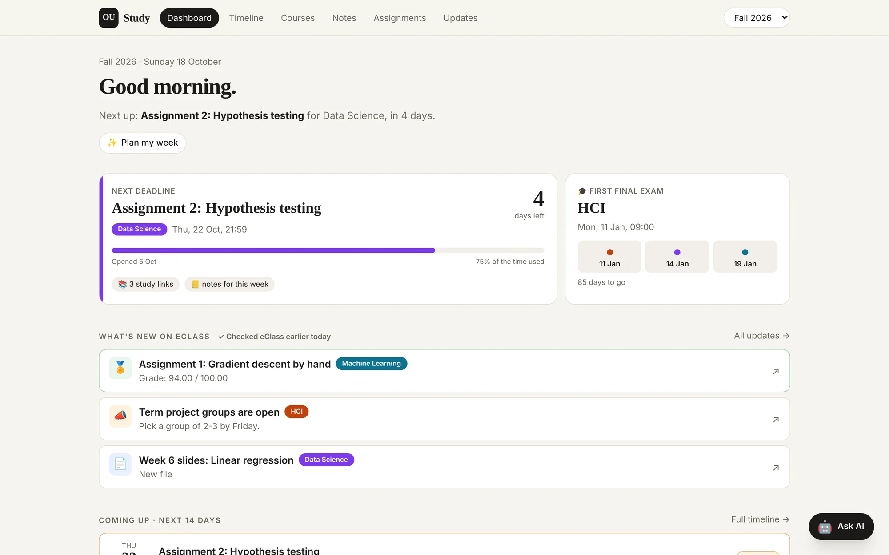
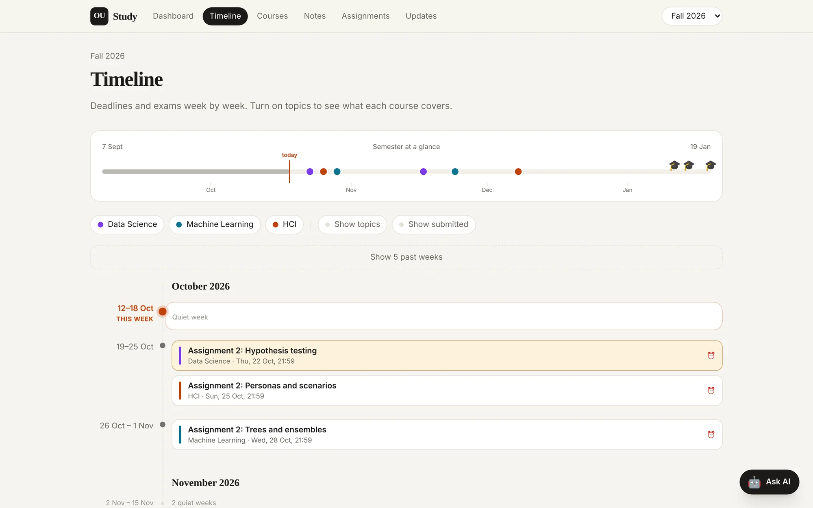
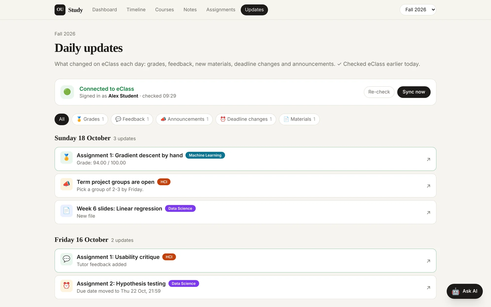

# OUC Study

Your Open University of Cyprus **eClass courses offline**, in a visual study app: every slide and file, assignment questions, your own submissions and grades, a semester timeline, daily alerts for new grades, feedback and deadlines, and AI study agents (Claude Code, Codex or a local model).

Built by students for students. Works with **your own** eClass account: nothing is shared between users.

<picture>
  <source media="(prefers-color-scheme: dark)" srcset="docs/images/dashboard-dark.webp">
  
</picture>

<sub>Screenshots use a made-up demo semester. They follow your light or dark theme.</sub>

## A quick tour

<table>
<tr>
<td width="50%" valign="top">

<picture>
  <source media="(prefers-color-scheme: dark)" srcset="docs/images/course-dark.webp">
  
</picture>

**Every course, week by week**<br>Slides, recordings, readings and your notes for each week, with upcoming work and grades on the side.

</td>
<td width="50%" valign="top">

<picture>
  <source media="(prefers-color-scheme: dark)" srcset="docs/images/timeline-dark.webp">
  
</picture>

**The whole semester at a glance**<br>Every deadline and final exam on one line, then week by week with a filter per course.

</td>
</tr>
<tr>
<td width="50%" valign="top">

<picture>
  <source media="(prefers-color-scheme: dark)" srcset="docs/images/note-dark.webp">
  
</picture>

**Visual notes**<br>Notes your AI writes from the slides: big idea, concept cards, diagrams, formulas and flashcards.

</td>
<td width="50%" valign="top">

<picture>
  <source media="(prefers-color-scheme: dark)" srcset="docs/images/assignment-dark.webp">
  
</picture>

**Assignments with a prep pack**<br>The question, your files, study links and an AI prep pack with hints, never the answers.

</td>
</tr>
<tr>
<td width="50%" valign="top">

<picture>
  <source media="(prefers-color-scheme: dark)" srcset="docs/images/ask-ai-dark.webp">
  
</picture>

**Ask AI, on any page**<br>Chat with Claude Code, Codex or a local model about what you're looking at. It knows your courses and notes.

</td>
<td width="50%" valign="top">

<picture>
  <source media="(prefers-color-scheme: dark)" srcset="docs/images/updates-dark.webp">
  
</picture>

**What changed on eClass**<br>New grades, feedback, files, moved deadlines and announcements, checked every day.

</td>
</tr>
</table>

## Install

Works on **macOS and Windows** (and Linux, without starting at login). You need [Node.js](https://nodejs.org) (the LTS version), [git](https://git-scm.com) and a few minutes.

```bash
git clone <this repo> OUC-Study
cd OUC-Study
npm run setup
```

On a Mac you can also double-click **`Install OUC Study.command`**, on Windows **`Install OUC Study.cmd`**. Afterwards **`Start Study App.command`** / **`Start Study App.cmd`** opens the app.

The installer walks you through everything:

1. **Checks your computer** and installs the app.
2. **Connects to eClass** with your personal key. It shows you where to get it, and you paste it hidden (or it reads it from the clipboard).
3. **Lists your enrolled courses**. The current ones are already ticked.
4. **Downloads everything**: weekly slides and files, assignment briefs and questions, your submitted files, grades and feedback.
5. **Finishes the setup**: searchable text copies for your AI assistant, daily updates, your preferences for the assistant.
6. **Starts the app**, automatically at every login on macOS and Windows. Open **http://localhost:5173**, or type `ouc open`.

Want to see first what it would download? Run `npm run setup -- --dry-run`. It changes nothing.

### Your eClass key

The app reads eClass through its official web-service API, the one the Moodle mobile app uses. It needs your personal key:

- eClass → **Preferences → Security keys** (https://eclass.ouc.ac.cy/user/managetoken.php), row **Moodle mobile web service** → copy (or **Reset** to get a new one).
- No such row? Install the **Moodle** app on your phone and sign in to `eclass.ouc.ac.cy` once (Office365 Login).

The key is saved in `.eclass-token`, readable only by you and never committed. **Don't share it**: it gives access to your eClass account.

## The `ouc` command

| Command | What it does |
|---|---|
| `ouc open` | open the app in your browser (starts it if needed) |
| `ouc sync` | check eClass **now**: grades, feedback, deadlines, announcements **and new files** |
| `ouc pull` | download any new course files (`--dry-run` just lists them) |
| `ouc setup` | add courses, start a new semester, or replace your key |
| `ouc status` | is the app running, is the daily sync scheduled, when was the last sync |
| `ouc start` · `ouc stop` · `ouc restart` | control the background app |
| `ouc update` | update to the latest release (`ouc restart` does this too; `--check` only looks, `--main` follows main instead of releases) |
| `ouc logs` · `ouc logs sync` | follow the logs (macOS `~/Library/Logs/OUC-Study/`, Windows `%LOCALAPPDATA%\OUC-Study\Logs\`) |
| `ouc check-public` | before pushing to GitHub: is anything personal included? |
| `ouc uninstall` | turn off auto-start and the daily sync |

How it runs in the background: on macOS two LaunchAgents (`~/Library/LaunchAgents/cy.ouc.study.*`); on Windows a hidden launcher in your Startup folder and a Task Scheduler task "OUC Study eClass sync" (no admin rights needed); on Linux `ouc start` runs it until you log out. Prefer no background service? `npm run dev` runs the app in the current terminal window.

## Pages

- **Dashboard**: next deadline with a countdown, the final exams, the next live class of each course, what's new on eClass, the next 14 days, and progress per course.
- **Timeline**: the semester at a glance, then week by week (deadlines, live classes, exams), with filters per course.
- **Courses**: each course week by week (slides, videos, assignments, your notes, the week's live class) plus your grades.
- **Notes**: visual notes with diagrams, LaTeX formulas, comparison tables and flip-card self-tests.
- **Assignments**: the question, files, PDF preview, study links, grade and feedback.
- **Updates**: what changed on eClass each day, with a live 🟢 connection status, **Re-check** and **Sync now**.
- **Ask AI** (button in the top bar, on every page): talk to your AI assistant from the app. See [Ask AI in the app](#ask-ai-in-the-app).

### Live classes

eClass has one **Webconference** link per course but no dated schedule. The sync reads the weekly class time from eClass itself: the Webconference description (for example a table of teaching groups and their times) and the tutors' announcements ("our meeting will be on Thursdays at 6pm"). It also picks up posts that move a class ("rescheduled for Thursday, 1 October, at 20:00"), and reads your teaching group, so you see your group's time. Each class has the join link and links to that week's notes, slides and readings (and the meeting agenda when the tutor posts one), so you can prepare. The course page shows which sentence the time came from.

Times are Cyprus time (set `"timezone"` at the top of `semesters/<id>/semester.json` to change that); the app shows them in your computer's time zone. If a time is wrong or missing (for example a time agreed in class and never posted), press **Wrong time? Fix it** under the next class on the course page and type the time as it shows in your own calendar; the app converts it and saves it in `semester.json`, where it wins over what was read from eClass. You can also edit it there:

```json
"classes": {
  "day": "Tue", "time": "19:00",
  "groups": { "F.02": { "time": "20:00" }, "F.03": {} }, "group": "F.03",
  "changes": [{ "date": "2026-12-08", "cancelled": true }]
}
```

## Daily updates

Every morning at 07:30 (and every 4 hours while the app runs) it asks eClass what changed: **new grades, tutor feedback, submission status, new or updated files, deadline changes, new assignments, announcements, forum replies and notifications**. These appear on the **Updates** page and the dashboard. On a Mac you also get a notification. If the computer was off or asleep at 07:30, the check runs when it's back.

New files are downloaded into the right week folder. Existing files are never overwritten: a newer version is saved next to the old one as `name (updated YYYY-MM-DD).ext`.

The dot in the top bar shows the connection: 🟢 connected, 🔴 key expired or wrong (run `ouc setup`), 🟠 offline, ⚪ not set up. Click it to see eClass and your AI tools (Claude Code, Codex, opencode): installed or not, signed in or not, and the command that fixes each one.

## Using it with an AI assistant

The study tools work with **Claude Code**, **OpenAI Codex** or a **local model through opencode**. Setup asks which one you want and sets it up for you: it installs the tool, signs you in, and for a local model installs Ollama or LM Studio and downloads a model that fits your computer. Change it any time with `ouc ai setup`.

| AI | Runs on | Setup does |
|---|---|---|
| Claude Code | your Claude Pro/Max subscription | installs `@anthropic-ai/claude-code`, runs `claude auth login` |
| Codex | your ChatGPT subscription | installs `@openai/codex`, runs `codex login` |
| opencode + local model | your computer, free and offline | installs `opencode-ai` and Ollama or LM Studio, downloads the model, gives it a 32k context window |
| a local model directly | your computer, free and offline | installs Ollama or LM Studio and downloads the model; notes, plans and quizzes only, lighter |

Claude Code and Codex are used with **your own subscription login, never API credits**: `ouc ai` checks that you're signed in with your account, and it ignores `ANTHROPIC_API_KEY` / `OPENAI_API_KEY` when it starts them.

**Local models.** The default is `gpt-oss:20b` on computers with 24 GB of memory or more, otherwise `qwen3:8b` (LM Studio: `openai/gpt-oss-20b` / `qwen/qwen3-8b`). opencode needs a model that can call tools and a context window of 32k tokens: with Ollama, setup makes a copy such as `qwen3-32k:8b`; with LM Studio, it loads the model with `--context-length 32768`. Your choice is saved in `.opencode/opencode.json`; the shared `opencode.json` keeps your eClass key off limits.

```
ouc ai                 open your assistant in this folder
ouc notes [course] [week]   visual notes for a week (default: the latest week without notes)
ouc plan               plan this week
ouc quiz [course] [week]    quiz yourself
ouc ai status          what's installed and signed in
--with claude|codex|opencode|local   use another one just this time
```

You can also just open the folder in the tool itself (`claude`, `codex` or `opencode`). `AGENTS.md` explains the workspace to all of them (Claude Code reads it through `CLAUDE.md`), and your personal context (name, learning style, current semester) is in `STUDENT.md`, which setup creates.

| Agent | Does |
|---|---|
| note-taker | turns slides and readings into visual notes, and fills in the glossary |
| study-planner | plans weekly study and deliverables, and flags risks |
| researcher | finds and checks papers, chapters, videos and tutorials, with citations |
| tutor | explains, quizzes, reviews drafts, and logs weak spots |
| assignment-reviewer | reviews your draft before you submit it, against the brief, the rubric and the course material |

Skills: `plan-week`, `make-notes`, `research-topic`, `find-material`, `quiz-me`, `assignment-helper`, `assignment-prep`, `assignment-review`, `sync-eclass`. They live in `ai/`; `ouc ai install` copies them to `.claude/` (Claude Code), `.agents/skills/` (Codex and opencode) and `.opencode/agents/` (opencode subagents). Run it again after editing them.

Try: "plan my week" · "make notes on lecture 7" · "find material on signal detection theory" · "quiz me on Naive Bayes" · "help me approach the term project" · "what's new on eClass?"

The assistant helps you understand, plan and review. It won't write answers for you to submit.

### Ask AI in the app

Press **✨ Ask AI** in the top bar. Pick an action (Make notes, Quiz me, Plan my week, Research a topic, Find material, Assignment help, Sync eClass) or just type a question. The app runs the AI you chose with `ouc ai setup` on your own computer, with your own login, and shows its reply as it works. Notes and plans it writes appear as links, and new notes show up in the app straight away. Shortcuts open the panel with the right action filled in: **Plan my week** on the dashboard, **Make notes** and **Quiz me** on a course week, **Quiz me on this** on a note, **Help me with this** on an assignment.

- Every skill in `ai/skills/` becomes an action automatically.
- The AI edits files in this folder without asking each time (like `ouc notes`), with the same limits as the command line. Claude Code and opencode are blocked from reading your eClass key, and every AI is told never to touch it.
- With "a local model directly" you can chat and quiz; the other actions need Claude Code, Codex or opencode.
- **Prep packs:** every assignment you haven't submitted (including ones not open yet) gets a `PREP.md` in its folder (what it asks, key ideas, hints, course material, extra reading, a plan), shown on the assignment page. The app makes them on its own when it starts and after each sync. On the assignment page you can ask another AI to **Review & improve** it, **Add more**, or **Start over**. To turn the automatic part off, add `"autoPrep": false` to `.ouc/ai.json`.
- **Review before submitting:** on the assignment page, upload your solution as a Word `.docx`. Your AI reviews it against the brief, the marking criteria, that week's material and your notes, and says what to fix and why (it never rewrites your answers). Discuss it in Ask AI, upload the fixed version for another round (every round is kept), and when you're happy press **Approve**: your `.docx` becomes a PDF, unchanged, ready to upload on eClass. Making the PDF uses [LibreOffice](https://www.libreoffice.org/download/) (free; on a Mac `brew install --cask libreoffice`). Your drafts stay in the assignment's `review/` folder, never shared.
- **Sync now** (Updates page) also downloads new course files, then has your AI make every missing note (all weeks with files, started or not) and prep pack. A bar under the top menu shows the progress; click a running item to watch it. Up to 3 run at once; set `"parallel": 5` (1–8) in `.ouc/ai.json` to change that.
- Chats are saved on your computer in `.ouc/chats/` (never committed). **History** in the panel reopens them.
- It only works in the app running on your computer (`ouc open` or `npm run dev`), and only pages from that app can use it.

## How it's organised

```
apps/web/             the React app (Vite + Tailwind)
packages/content/     turns semesters/ into data for the app
packages/eclass-sync/ eClass API: daily changes (src/daily.ts), file downloads (src/pull.ts)
packages/ai/          AI backends, study actions and the /api/ai server behind the Ask AI panel
packages/cli/         the ouc command, the installer, the background server (TypeScript)
bin/                  launchers that start them
semesters/<id>/       YOUR data for each semester: course files, notes, assignments (git-ignored)
memory/               the assistant's memory of your progress (git-ignored)
ai/  tools/  docs/    agents & skills, helpers, the note format
```

## Privacy and sharing

This repository holds **only code**. Everything personal is git-ignored: `semesters/` (OUC course materials, your submissions, grades and notes), `memory/`, `STUDENT.md`, `.opencode/opencode.json` and `.eclass-token`.
Course materials belong to OUC and their authors, so don't commit or redistribute them; everyone downloads their own copy through their own enrolment.
Run `ouc check-public` before you push.

## Updates

New versions are published as [GitHub releases](https://github.com/g-terra/ouc-study/releases). The app checks for one once a day; when there is one, a bar under the top menu says **Update available**, with what's new and an **Update now** button. It moves your copy to that release, reinstalls what changed, and restarts the app; the page reloads when it's back. Your semesters, notes and memory are never touched.

From Terminal: `ouc update --check` (is there one?), `ouc update` (update), `ouc restart` (update and restart). Both follow releases; add `--main` to get the newest code on main instead. If you changed the code yourself, it doesn't update; commit or stash your changes first.

## Contributing

Bug reports, ideas and pull requests are welcome, including ones made with an AI coding agent (Claude Code, Codex, opencode, Cursor...). Start with [CONTRIBUTING.md](CONTRIBUTING.md): setup, the checks (`npm run check`), Conventional Commits and how releases work. Report security problems privately ([SECURITY.md](SECURITY.md)). Changes are listed in [CHANGELOG.md](CHANGELOG.md) once the first release is out.

## Troubleshooting

| Problem | Fix |
|---|---|
| The app doesn't open | `ouc status`, then `ouc logs`. Missing dependencies: `npm install`, then `ouc restart` |
| `ouc: command not found` | open a new terminal window, or use `node bin/ouc.mjs …` from this folder (`ouc link` installs the command again) |
| 🔴 eClass key expired | `ouc setup` (it asks for a new key; your files stay) |
| A file failed to download | `ouc pull` retries; failures are listed in `semesters/<id>/_meta/pull-report.json` |
| Week dates are off for a course | edit `dating.first` for that course in `semesters/<id>/semester.json` |
| Log shows "Operation not permitted" | System Settings → Privacy & Security → Full Disk Access → add your `node` (`which node`) → `ouc restart` |
| Port 5173 already in use | another copy is running (e.g. `npm run dev`). Close it, or `ouc stop` |
| Notes or data look stale | `npm run content` (the running app also rebuilds automatically) |
