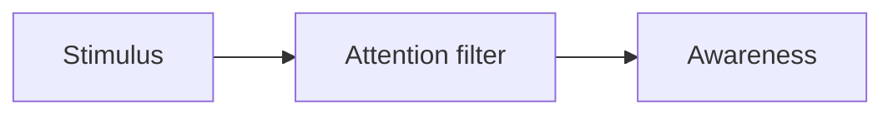

# Visual note format

Notes live in `semesters/<semester>/notes/<COURSE CODE>/<slug>.md`. The app renders them as visual pages.
They are plain Markdown plus a few **visual blocks**, so an AI assistant (or you) can write and edit them easily.

## Front matter (required)

```yaml
---
course: COS514
section: 4            # eClass section index, which links the note to its week
week: 3               # week / lecture number shown on the card
title: Lecture 3 · The Hodgkin-Huxley model
summary: One or two sentences: what this class is about.
source: courses/COS514-Computational-Neuroscience/04-26-September---2-October/COS514_WM-Lecture 3.pdf
tags: action potential, ion channels, ODEs
---
```

## Page structure (use this order)

1. `> [!IDEA] Big idea`: the one-paragraph takeaway.
2. `## Key concepts`: a `cards` block (3–6 cards).
3. `## How it fits together`: a `mermaid` diagram (flow, cycle or concept map).
4. Topic sections: use `compare`, `steps`, `formula` and short Markdown. End each with a `> [!SOURCE]` line citing where its points come from (see [Sources](#sources)).
5. `## Key terms`: a `terms` block.
6. `## Check yourself`: a `flashcards` block (4–6 cards; hints, not assignment answers).
7. `> [!LINK] Connects to`: links to other weeks and courses. Name course files and other notes by their repo-relative path in `backticks` (e.g. `semesters/2026-Fall/notes/COS512/week-04-transformers.md`); the app turns them into links showing just the file name.
8. `## Go deeper`: a `links` block.
9. `## Sources`: a list of every course file the note was made from, each with the spots used.

## Sources

Every point should be traceable to the material. Cite a file by its path (from the semester folder, or the repo) in `backticks`, with the spot at the end:

| Material | Cite | Opens |
|---|---|---|
| PDF | `courses/…/Reading.pdf#page=12` (or `#page=12-14`) | the PDF at that page |
| Slides (.pptx) | `courses/…/Lecture 3.pptx#slide=5` (or `#slide=5-7`) | the app's slide viewer at that slide |
| Class video | `courses/…/Lecture 3.mp4#t=12:03` | the video page, playing from that moment |
| A recording that is only a link (Panopto) | `courses/…/Lecture 2.transcript.md#t=12:03` | its transcript at that line, with "Watch on Panopto" from that moment |
| Other files (.docx, notebooks) | the path alone | the file |

The app shows each citation as the file's name and the spot ("Reading.pdf, p. 12", "Lecture 3 at 12:03").
Where the numbers come from: PDF pages are the `--- page N ---` lines in the text copies (`<sem>/text/`), slides the `--- slide N ---` lines or a deck transcript's `## Slide N`, times a video transcript's `[mm:ss]` stamps. Never guess a spot: cite the file alone when you can't tell.

```md
> [!SOURCE]
> `courses/COS514-…/04-…/Lecture 3.pptx#slide=4-6`, `courses/COS514-…/04-…/Lecture 3.mp4#t=14:20`

## Sources

- `courses/COS514-…/04-…/Lecture 3.pptx#slide=1-22`: the lecture slides
- `courses/COS514-…/04-…/Lecture 3.mp4#t=0:00`: the recorded class
- `courses/COS514-…/00-General/Textbook ch2.pdf#page=31-38`: the reading
```

## Math

LaTeX everywhere: inline `$\tau = RC$`, display `$$ ... $$`. Inside YAML blocks, put LaTeX in **single quotes** or a `|` block,
so backslashes are kept as typed. Never "double quotes": there YAML reads `\m` as an error and `\tau` as a tab
followed by "au". `node packages/ai/validate.mjs <file>` flags it, and `--fix` rewrites it.

## Callouts

```md
> [!IDEA] Optional custom title
> Text with **markdown** and $math$.
```

Kinds: `IDEA` 💡, `KEY` 🔑, `TIP` ✅, `WARN` ⚠️, `EXAM` 🎯, `ANALOGY` 🧠, `LINK` 🔗, `SOURCE` 📄 (a quiet line, for citations).

## Visual blocks (fenced, YAML inside)

````md
```cards
- icon: 🧠
  title: Working memory
  text: |
    Holds about **4 chunks** (Cowan).
```

```formula
title: RC membrane
tex: '\tau \frac{dV}{dt} = -(V - V_{rest}) + R I'
where:
  - ['\tau = RC', membrane time constant]
  - ['R', membrane resistance]
note: Exponential approach to the steady state.
```

```compare
title: Feature vs conjunction search
headers: [ "", Feature, Conjunction ]
rows:
  - [ Target defined by, one unique feature, a combination of features ]
  - [ Search, parallel (pop-out), serial ]
```

```steps
title: Synaptic transmission
items:
  - title: Spike arrives
    text: Voltage-gated Ca²⁺ channels open.
  - title: Vesicles release transmitter
```

```terms
- term: Prior
  def: Belief before seeing the data.
```

```flashcards
- q: Why can we drop P(words)?
  a: It's the same for every class.
```

```links
- title: Neuronal Dynamics, ch. 2
  url: https://neuronaldynamics.epfl.ch/online/Ch2.html
  note: Free online textbook chapter.
```


````

Mermaid tips: quote every label (`A["text"]`), use `<br/>` for line breaks, keep 4–10 nodes.
