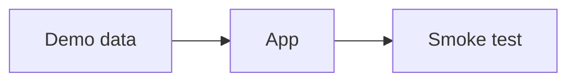

> [!IDEA] Big idea
Smoke tests open every page with this demo semester, so a broken build never reaches a release.

## How it fits together



## Math

The demo formula: $E = mc^2$.

```formula
title: Mass-energy equivalence
tex: 'E = m c^{2}'
where:
  - ['c', 'speed of light']
note: A made-up formula block for the search test.
```

```formula
title: Naive Bayes decision rule
tex: '\hat{c} = \arg\max_{c} P(c) \prod_{i=1}^{n} P(w_i \mid c)'
where:
  - ['c', candidate class]
  - ['P(c)', class prior]
  - ['P(w_i \mid c)', word likelihood under that class]
note: The evidence term is the same for every class, so it is left out.
```

> [!SOURCE]
> `courses/DEMO101-Demo-Studies/01-Week-1-Getting-started/Demo lecture.pptx#slide=2`, `courses/DEMO101-Demo-Studies/01-Week-1-Getting-started/Video-Welcome-to-the-demo/Welcome.mp4#t=0:30`

## Sources

- `courses/DEMO101-Demo-Studies/01-Week-1-Getting-started/Demo lecture.pptx#slide=1-2`: the demo lecture
- `courses/DEMO101-Demo-Studies/01-Week-1-Getting-started/Demo reading.pdf#page=2`: the demo reading
- `courses/DEMO101-Demo-Studies/01-Week-1-Getting-started/Video-Welcome-to-the-demo/Welcome.transcript.md#t=0:30`: what the welcome video says
