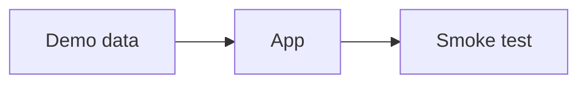

> [!IDEA] Big idea
Smoke tests open every page with this demo semester, so a broken build never reaches a release.

## How it fits together



## Math

The demo formula: $E = mc^2$.

```formula
title: Mass-energy equivalence
tex: 'E = m c^{2}'
where:
  - ['c', 'speed of light']
note: A made-up formula block for the search test.
```
